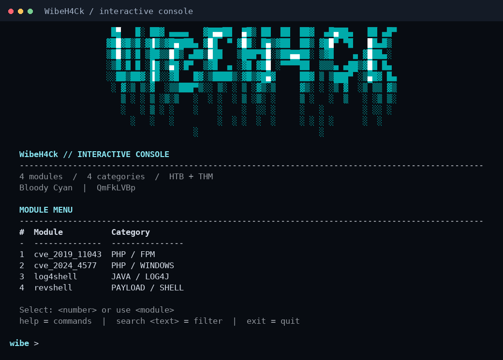
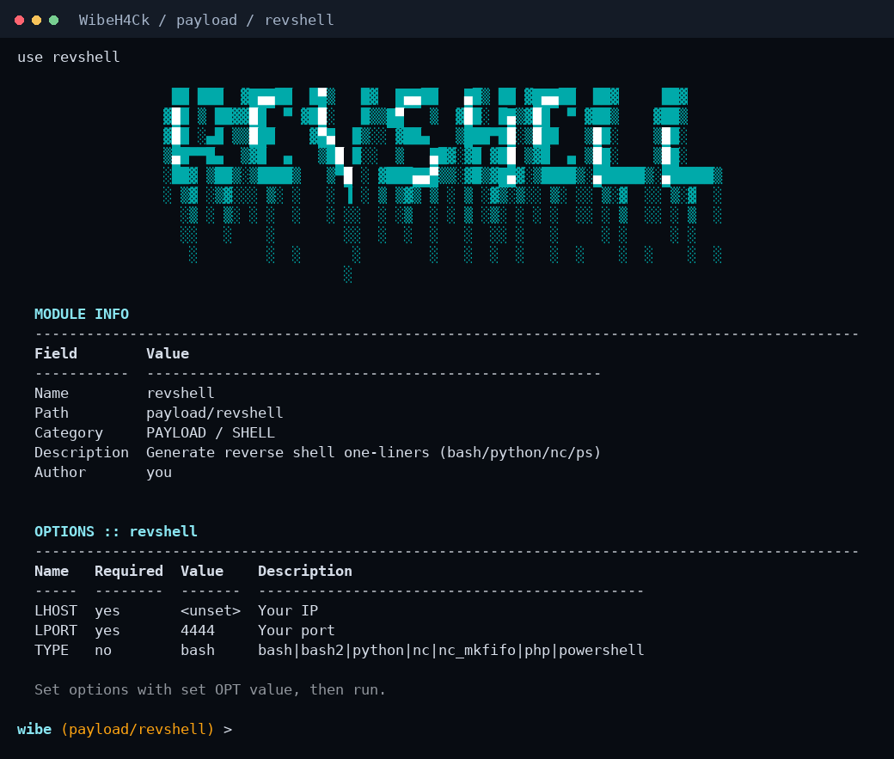

# WibeH4Ck

Модульний термінальний фреймворк для HTB/THM: Bloody Cyan банери, меню модулів, контекстний prompt і Tab-доповнення.



## Запуск

```bash
git clone https://github.com/QmFkLVBp/WibeH4Ck.git
cd WibeH4Ck
python3 rce.py
```

Саме `python3 rce.py` відкриває інтерактивну консоль. `--help` показує довідку щодо аргументів запуску.

```bash
python3 rce.py --help
python3 rce.py -l
python3 rce.py --no-color
python3 rce.py --no-banner
```

Рекомендоване середовище: Kali/Linux або macOS, Python 3.10+. Для інтерфейсу достатньо стандартної бібліотеки Python. Інтерактивне приєднання до сесій використовує POSIX-термінал; PowerShell-рядок призначений для Windows-цілі. Арти вже включені в репозиторій: інтернет, pyfiglet і rich для них не потрібні. Кольори автоматично вимикаються при перенаправленні виводу, через `NO_COLOR` або `--no-color`.

## Робота в консолі

Введи номер із меню або назву модуля:

```text
use revshell
set LHOST 127.0.0.1
set LPORT 4444
show options
```

Вибір модуля показує його Bloody-арт, опис та опції. Виконання починається лише після окремої команди `run`, `exploit` або `x`.



| Команда | Дія |
| --- | --- |
| `menu` | Меню з номерами модулів |
| `home` | Головний екран; знімає вибір модуля |
| `modules` | Усі модулі з категоріями та описами |
| `search <текст>` | Пошук за назвою, категорією чи описом |
| `use <назва або номер>` | Вибір модуля |
| `info` | Арт та опис поточного модуля |
| `show options` / `options` | Поточні значення й обов’язкові опції |
| `set <OPT> <значення>` | Задати опцію |
| `unset <OPT>` | Очистити обов’язкову опцію; повернути стандартне значення необов’язкової |
| `run` / `exploit` / `x` | Перевірити опції та виконати модуль |
| `listener <порт> [адреса]` | Запустити listener; типова адреса `0.0.0.0` |
| `listeners` | Показати listener-и та їхні ID |
| `listener stop <id>` | Зупинити приймання нових з’єднань |
| `sessions` | Показати відкриті й закриті сесії |
| `sessions -i <id>` | Приєднатися до сесії |
| `sessions -k <id>` | Закрити сесію |
| `back` | Вивантажити поточний модуль |
| `banner` / `clear` | Повторити арт / перемалювати екран |
| `exit` / `quit` | Вийти |

Tab доповнює команди, назви модулів після `use` і назви опцій після `set`/`unset`. Контекст у prompt показує шлях поточного модуля.

## Модулі й арти

| Модуль | Категорія | Bloody-арт |
| --- | --- | --- |
| `cve_2019_11043` | PHP / FPM | PHP FPM |
| `cve_2024_4577` | PHP / Windows | PHP CGI |
| `log4shell` | Java / Log4j | LOG4SHELL |
| `revshell` | Payload / Shell | REVSHELL |

Режим `-m <модуль> -o K=V` збережений. Невідомі параметри, неправильні URL/порти та помилки зовнішніх процесів завершують цей режим із ненульовим кодом. Некоректне значення `set` не замінює попереднє коректне значення. Опції різних екземплярів модуля незалежні.

## Сесії

```text
listener 4444
sessions
sessions -i 1
background
sessions -i 1
sessions -k 1
listener stop 1
```

Listener лише приймає з’єднання. Клавіатуру читає поточна консоль або вибрана через `sessions -i` сесія. Після підключення нового клієнта натисни Enter або введи `sessions`, щоб оновити список і повідомлення.

`background`, `bg` та Ctrl+C повертають у меню зі збереженням з’єднання. Дані у фоні буферизуються до 1 МіБ на сесію; при переповненні відкидаються найстаріші байти з повідомленням під час приєднання. `listener stop` залишає вже прийняті сесії відкритими. Вихід із програми закриває всі listener-и та сесії; після перезапуску вони не відновлюються.

Якщо запуск через `-m` залишив відкриту сесію після `background`, програма відкриє консоль для подальшого керування нею. Це звичайний потоковий shell; повноекранні програми й керування терміналом на віддаленій стороні можуть потребувати PTY.

## Зовнішні PoC

- Git потрібен для першого завантаження. Кеш: `~/.rce-tool/`.
- Python-PoC отримують власну `.venv` у своєму каталозі. Потрібен модуль `venv` (у Kali/Debian — пакет `python3-venv`). Залежності перевіряються і для вже завантаженого PoC; невдала інсталяція зупиняє запуск і повторюється наступного разу.
- PHP-FPM потребує Go. Виклик залишається `go run . <TARGET>` з позиційним URL.
- Log4Shell потребує **JDK 1.8.0_20**. Обгортка перевіряє версії `java` і `javac` та узгоджує їх із шляхом, який використовує upstream PoC. Можна розмістити JDK у `~/.rce-tool/log4j-shell-poc/jdk1.8.0_20/` або задати `JAVA` і `JAVAC` повними шляхами до одного JDK; у другому випадку створюється символічне посилання. Наявний JDK автоматично не замінюється.
- `LPORT`, `WEBPORT` і LDAP-порт `1389` мають бути різними та вільними. Listener запускається перед HTTP-запитом, HTTP/LDAP-сервери перевіряються на готовність. `TIMEOUT` задає очікування з’єднання в секундах (типово 60). Процеси PoC та його дочірні процеси зупиняються після завершення або помилки.

Перше завантаження клонує поточний стан upstream; кеш самостійно не оновлюється. Сумісність з іншими версіями зовнішніх PoC потребує перевірки. Під час вибору модуля, перегляду опцій і пошуку нічого не встановлюється.

## Перевірка

```bash
python3 -W error -m py_compile rce.py framework.py terminal_ui.py sessions.py poc_support.py modules/*.py
python3 -W error -m unittest discover -s tests -v
python3 rce.py -l
```

Перевірки охоплюють консоль, валідацію, незалежність опцій, локальні TCP-сесії, від’єднання/повернення, буферизацію, ізоляцію Python і завершення дочірніх процесів. Зовнішні PoC, установлення їхніх пакетів та HTTP-запити до цілей у тестах замінені імітаціями. Якщо встановлений `pwsh` або `powershell`, додатково перевіряється обмін виразом `1+1` через локальне з’єднання; інакше цей тест позначається як пропущений.

## Новий модуль

1. Скопіюй `modules/_template.py` у `modules/<назва>.py`.
2. Заповни `name`, `description`, `options` та `run()`.
3. Перезапусти консоль.

Опції можуть містити `choices` для обмеженого набору значень або `kind: "url"` для HTTP(S)-адрес. Власний конструктор модуля має викликати `super().__init__()`. Для прийнятого сокета використовуй `interactive_shell(sock, manager=self.sessions)`, щоб `background` залишав сесію доступною в загальній консолі.

Для окремої категорії й арту додай запис у `MODULE_STYLE` у `terminal_ui.py`. Вузький термінал або непідтримуваний символ отримує читабельний текстовий заголовок.

Гліфи й cyan-палітра: [TAAG, Bloody / TheDraw](https://patorjk.com/software/taag/). Цифра `4` додана локально, оскільки вихідний шрифт не містить цифр. Деталі — в [assets/README.md](assets/README.md).
